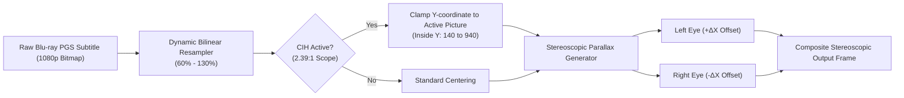

# VLC4MVC — 3D MVC Blu-ray Player for Android TV & Nvidia Shield Pro

[](https://www.gnu.org/licenses/gpl-3.0)
[](https://developer.android.com/tv)
[](https://www.nvidia.com/en-us/shield/)
[](#installation)

**VLC4MVC** is a high-performance open-source fork of VLC for Android TV, engineered specifically to play full-quality **3D MVC (Multiview Video Coding) Blu-ray rips** directly on the **Nvidia Shield TV Pro** without paying for expensive subscription software (such as Aspecta).

Whether connected to a 4K 3D projector (such as the **NexiGo Aurora Pro**, **Formovie Theater**, **BenQ**, or **Optoma**) or a 3D OLED/LED TV, VLC4MVC decodes both the base AVC stream and dependent MVC stream in real time and transforms them into your display's native 3D stereoscopic format.

---

## Table of Contents

- [Key Features](#key-features)
- [Stereoscopic 3D Output Modes](#stereoscopic-3d-output-modes)
- [3D Blu-ray (PGS / SUP) Subtitle System](#3d-blu-ray-pgs--sup-subtitle-system)
- [UI & Theme Customization](#ui--theme-customization)
- [Comparison: VLC4MVC vs. Aspecta vs. Stock VLC](#comparison-vlc4mvc-vs-aspecta-vs-stock-vlc)
- [Installation Guide](#installation-guide)
  - [Method 1: AFTVnews Downloader (Recommended for Shield Remote)](#method-1-aftvnews-downloader-recommended-for-shield-remote)
  - [Method 2: GitHub Releases (Direct APK)](#method-2-github-releases-direct-apk)
  - [Method 3: Google Drive & USB Drive](#method-3-google-drive--usb-drive)
- [Quick Start & Playback Guide](#quick-start--playback-guide)
  - [Recommended Projector Configuration (NexiGo Aurora Pro Example)](#recommended-projector-configuration)
  - [Remote Control Shortcuts](#remote-control-shortcuts)
- [Building from Source](#building-from-source)
- [License & Acknowledgments](#license--acknowledgments)

---

## Key Features

- **Hardware-Accelerated Dual-Stream 3D MVC Decoding:**
  Plays unaltered 3D Blu-ray MKV rips made directly with [MakeMKV](https://www.makemkv.com/). No prior re-encoding to half-resolution SBS or TAB is required.
- **7 Flexible Stereoscopic Output Modes:**
  Outputs Full-SBS, Full-TAB, Half-SBS, Half-TAB, 4K Full-Fidelity Half-SBS/TAB, Frame Sequential (active shutter 120Hz), and Anaglyph 3D.
- **Dynamic Blu-ray (PGS / SUP) Subtitle Resizing:**
  Bitmap-based PGS subtitles on Blu-rays are notoriously oversized for large projection screens (100"–150"). VLC4MVC allows on-the-fly resizing from **60% to 130%** using bilinear resampling to preserve razor-sharp legibility.
- **Constant Image Height (CIH) 2.39:1 Subtitle Clamping:**
  For users with 2.35:1 or 2.39:1 CinemaScope projection screens, subtitles that normally spill into the letterbox black bars are automatically repositioned into the active image.
- **True 3D Floating Subtitle Depth (Stereoscopic Parallax):**
  Subtitles are rendered for both eyes simultaneously with calculated horizontal parallax offsets ($\pm \Delta X$), ensuring they float comfortably in front of the 3D scene without causing eye strain.
- **Instant Eye Swapping:**
  Toggle left/right eye order instantly via the on-screen menu without having to invert your projector 3D sync glasses.
- **Customizable TV Interface & Accent Colors:**
  Choose between 5 bespoke themes: Matrix Green, Classic Orange, Cyber Blue, Cinema Red, and Neon Purple.
- **100% Free & Open Source:**
  No subscriptions, no recurring in-app purchases, no telemetry, and no account requirements.

---

## Stereoscopic 3D Output Modes

Select your desired output mode during playback via the player OSD menu or permanently under `Settings` &rarr; `Video` &rarr; `3D MVC Output Mode`:

| Mode | Target Resolution | Recommended Display / Use Case |
| :--- | :--- | :--- |
| **Monoscopic (2D)** | 1920×1080 | Standard 2D playback (Left eye stream only). |
| **Full Side-by-Side (SBS)** | 3840×1080 | High-end 3D displays and VR headsets supporting full dual 1080p side-by-side. |
| **Full Top-and-Bottom (TAB)** | 1920×2160 | Full dual 1080p vertical frame-packing. |
| **Half Side-by-Side (HSBS 1080p)** | 1920×1080 | Standard anamorphic 3D TV / projector SBS mode (960×1080 per eye). |
| **Half Top-and-Bottom (HTAB 1080p)** | 1920×1080 | Standard anamorphic 3D TV / projector TAB mode (1920×540 per eye). |
| **Half SBS (4K Canvas)** | 3840×2160 | **Optimal for 4K 3D Projectors (NexiGo Aurora Pro):** Transmits both 1080p eyes side-by-side inside a native 4K frame without loss of horizontal resolution. |
| **Half TAB (4K Canvas)** | 3840×2160 | **Optimal for 4K 3D Projectors:** Transmits both 1080p eyes stacked inside a native 4K frame without loss of vertical resolution. |
| **Frame Sequential** | 1920×1080 @ 120Hz | 3D-Ready DLP Link displays and active shutter setups. |
| **Red / Cyan Anaglyph** | 1920×1080 | Legacy red/cyan 3D glasses playback on any standard screen. |

---

## 3D Blu-ray (PGS / SUP) Subtitle System

Standard media players render Blu-ray PGS subtitles as fixed-size bitmap graphics that fall into letterbox black bars and cause visual clash in 3D. VLC4MVC introduces a dedicated subtitle pipeline:



### Subtitle Size Presets (`Settings` &rarr; `Subtitles`):
- **60% (Ultra-Compact):** Recommended for screens $\ge$ 120 inches to minimize reading distractions.
- **75% (Small - Cinema Scope):** Clean cinematic subtitling.
- **85% (Compact):** Balanced reading size for medium home theaters.
- **100% (Normal - Default Blu-ray):** Standard 1:1 mastered Blu-ray size.
- **115% (Large):** For viewers seated farther away.
- **130% (Extra Large):** High visibility.

---

## UI & Theme Customization

Personalize your Android TV interface under `Settings` &rarr; `Interface` &rarr; `Theme Accent Color (VLC4MVC)`:

- **Matrix Green (VLC4MVC Default):** Modern dark cyber aesthetic (`#1E6B2D` brand header / `#43A047` accent).
- **Classic Orange:** Stock VideoLAN VLC styling.
- **Cyber Blue:** High-tech cobalt blue theme.
- **Cinema Red:** Home-theater friendly dark red (reduces room ambient reflection).
- **Neon Purple:** Stylish synthwave violet.

---

## Comparison: VLC4MVC vs. Aspecta vs. Stock VLC

| Capability | VLC4MVC | Aspecta | Stock VLC for Android |
| :--- | :---: | :---: | :---: |
| **Cost** | **100% Free** | **$49.99/yr or $8.99/mo** | 100% Free |
| **Play MakeMKV 3D MVC Blu-ray Rips** | **Yes (Direct)** | Yes (Direct) | No (Plays 2D only) |
| **Nvidia Shield TV Pro Support** | **Native ARM64** | Native ARM64 | Native |
| **Full SBS / Full TAB (3840×1080 / 1920×2160)** | **Yes** | Yes | No |
| **4K Canvas Half SBS/TAB (Lossless resolution)** | **Yes** | No | No |
| **Swap Left/Right Eyes On-the-Fly** | **Yes** | Yes | No |
| **Blu-ray SUP/PGS Dynamic Resizing (60%–130%)**| **Yes** | No | No |
| **CIH 2.39:1 In-Frame Subtitle Clamping** | **Yes** | Yes | No |
| **3D Stereoscopic Floating Subtitle Parallax** | **Yes** | Partial | No |
| **Custom Theme Accent Colors** | **Yes (5 Themes)** | No | No |
| **Network SMBv2 / SMBv3 NAS Streaming** | **Yes** | Yes | Yes |

---

## Installation Guide

### Method 1: AFTVnews Downloader (Recommended for Shield Remote)

No computer, USB thumb drive, or file manager needed!

1. On your Nvidia Shield, open the **Google Play Store**, search for **Downloader** (by AFTVnews with an orange icon), and install it.
2. Launch **Downloader**, navigate to the URL bar, and enter the **5-digit short code**:
   ```
   [ENTER YOUR 5-DIGIT CODE HERE]
   ```
3. Click **Go**. Downloader will fetch `VLC4MVC.apk` directly.
4. When prompted, click **Install**. (If prompted to allow Unknown Sources for Downloader, enable it in Android Settings and click Install).

### Method 2: GitHub Releases (Direct APK)

1. Navigate to the [Releases](https://github.com/writesimplybcc/vlc4mvc/releases) page.
2. Under the latest `v1.0.0` release, download `VLC4MVC.apk` (approx. 88.6 MB).
3. Sideload via `adb`:
   ```bash
   adb connect <SHIELD_IP>:5555
   adb install -r VLC4MVC.apk
   ```

### Method 3: Google Drive & USB Drive

1. Download `VLC4MVC.apk` from the shared Google Drive folder to your PC or phone.
2. Copy the APK file to a USB flash drive formatted as exFAT or NTFS.
3. Plug the drive into your Nvidia Shield Pro.
4. Open a file manager on the Shield (e.g., *X-plore* or *FX File Explorer*) and install `VLC4MVC.apk`.

---

## Quick Start & Playback Guide

### Recommended Projector Configuration

*(Example using the **NexiGo Aurora Pro** 4K UST Laser Projector)*:

1. **In VLC4MVC:**
   - Go to `Settings` &rarr; `Video` &rarr; set `3D MVC Output Mode` to **Full TAB** or **Half TAB (4K Canvas)**.
   - If using 2.35:1/2.39:1 scope, enable `Keep Subtitles Inside 2.39:1 (CIH)`.
   - Set `Blu-ray (SUP) Subtitle Size` to **75%** or **85%**.
2. **Start Video:**
   - Browse to your NAS (SMB) or local storage and launch your 3D MKV movie.
3. **On the NexiGo Remote:**
   - Press the projector **Settings** button &rarr; navigate to **Display / 3D**.
   - Switch 3D mode from **Off** to **Top-and-Bottom (TAB)**.
   - Put on your DLP Link active shutter glasses.
   - If the depth feels inverted (background appears in front), either toggle **Invert 3D** on your glasses or press the **Swap Eyes** button in the VLC4MVC playback menu.

### Remote Control Shortcuts

During playback on Android TV:
- **D-Pad Center (OK):** Play / Pause.
- **D-Pad Down:** Show video timeline and quick controls.
- **Subtitle Button:** Audio & Subtitle track selector.
- **Video Settings Button:** Quick 3D mode switcher (Monoscopic, Full SBS, Full TAB, Half SBS, Half TAB, Swap Eyes).

---

## Building from Source

To compile VLC4MVC from scratch:

### Prerequisites:
- Ubuntu 22.04 / 24.04 (or WSL2 on Windows 11).
- Android NDK `r27` or `r21d` and Android SDK platform tools.
- JDK 17, Gradle 9.6+, Meson, Ninja, CMake, Automake.

### Build Commands:
```bash
# Clone the repository
git clone https://github.com/writesimplybcc/vlc4mvc.git
cd vlc4mvc

# Initialize environment
export ANDROID_SDK=/path/to/android-sdk
export ANDROID_NDK=/path/to/android-sdk/ndk/27.2.12479018

# Compile LibVLC and Android TV application for ARM64
./buildsystem/compile.sh -a arm64 -b
```

The resulting package will be generated at:
```
application/app/build/outputs/apk/dev/VLC-Android-3.7.2-all.apk
```

---

## License & Acknowledgments

- **License:** GNU General Public License v3 (GPL-3.0).
- **Upstream Project:** [VLC for Android](https://code.videolan.org/videolan/vlc-android) by VideoLAN.
- Special thanks to the open-source multimedia community, VideoLAN authors, and 3D home theater enthusiasts.
